# Rail Globe

[中文](README.md) | English

Railways, metros and trams of China, Japan, South Korea and the UK, drawn on a satellite globe.

**Open the map: https://rail-globe.github.io/**

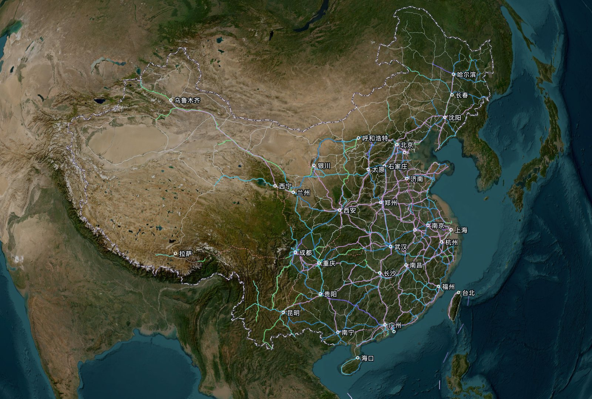

## What you can do

- **Browse lines**: all four countries are drawn on the globe at once, or on a flat map. Zoom in on a station to see its platforms, every track and the depots.
- **Search**: stations, lines, cities and countries in one box, by their local, Chinese or English names.
- **Pick a line**: click a line to light it up; its card gives the class and design speed.
- **Find a route** (China): the way between two stations along real lines, with distance and estimated time. Rail and metro are combined, with walking changes between nearby stations.
- **Trains** (China): where every train is now, or at any other time, estimated from the timetable. Pick a train to see its whole route, its stops and the lines it runs on. Positions are estimates, not live tracking.
- **中文 / English**: switch the interface and the way names are written.

## Colours

One set of rules for every country, never by operator:

1. High-speed and EMU lines by **design speed**, in seven bands: >350, 350, 300, 250, 200, 160, <160 km/h.
2. Other railways in their official line colour, or a neutral light colour if they have none.
3. Metro, light rail and tram lines in their official colours.


Dashed lines are under construction. Each line is drawn once; lines sharing or hugging the same track are drawn side by side and come back onto their own tracks as you zoom in.

## Screenshots

| 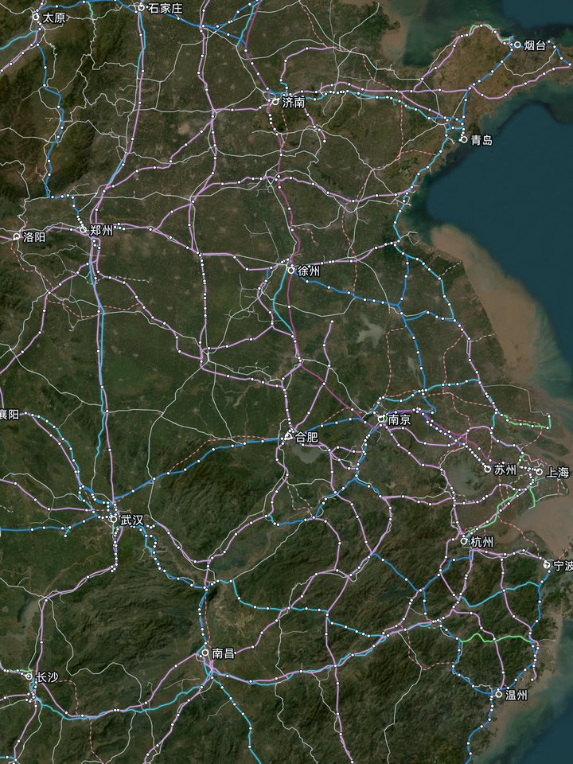 | 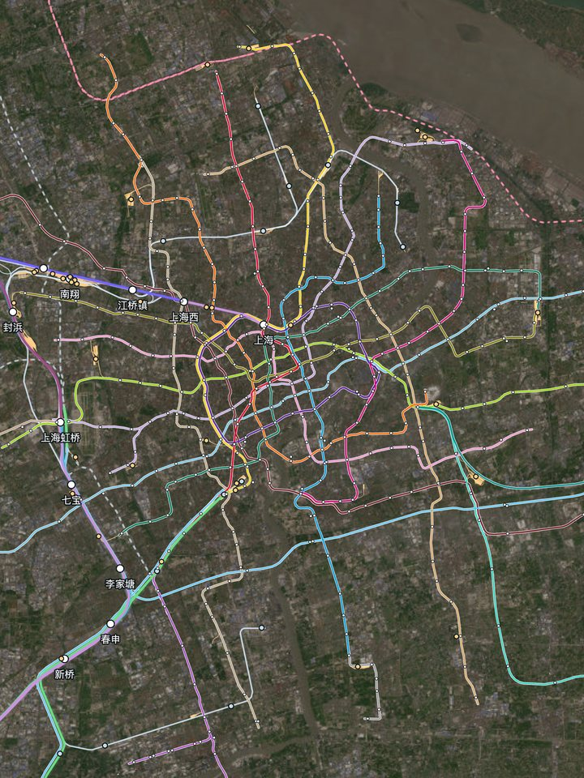 | 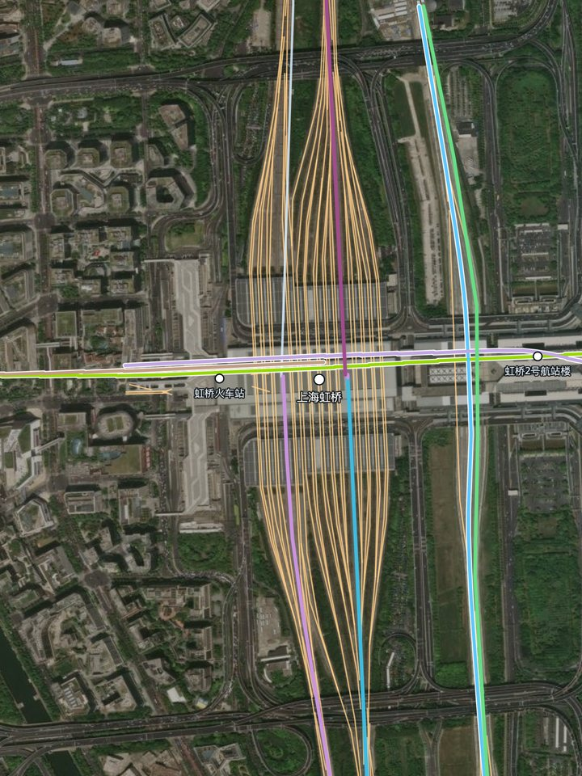 |
|:-:|:-:|:-:|
| High-speed lines in East China, by design speed | Shanghai Metro | The tracks of Shanghai Hongqiao |
| 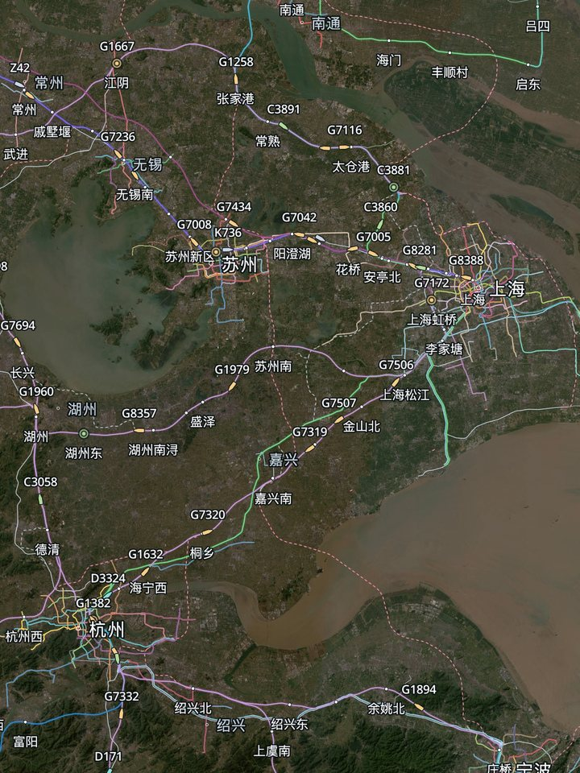 | 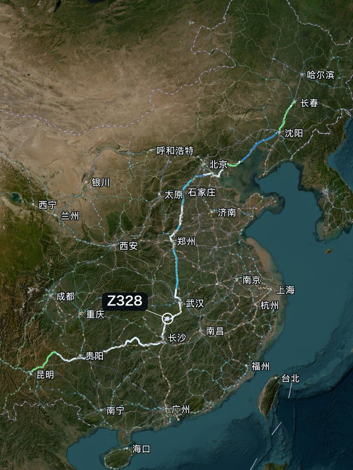 | 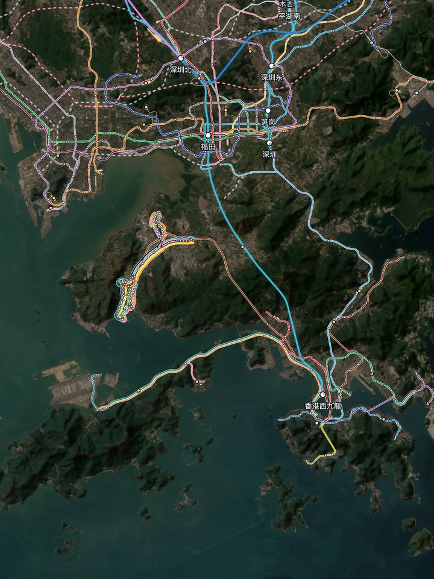 |
| Trains, positions estimated from the timetable | Train Z328, Changchun to Kunming | Hong Kong and Shenzhen |
| 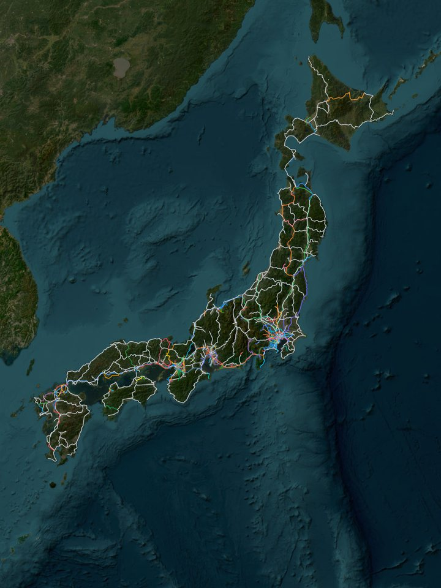 | 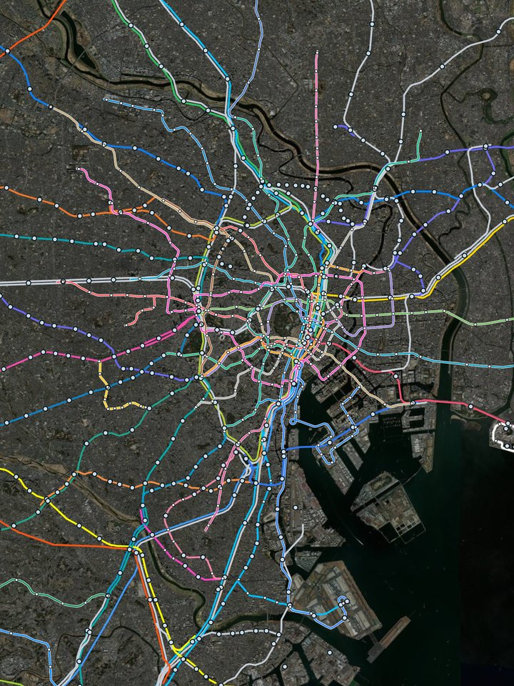 | 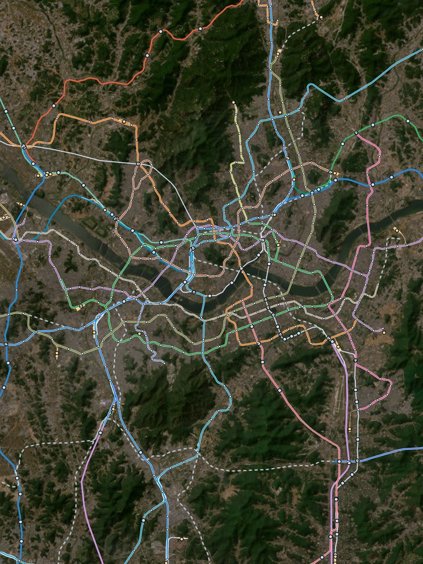 |
| Japan | Tokyo | Seoul |
| 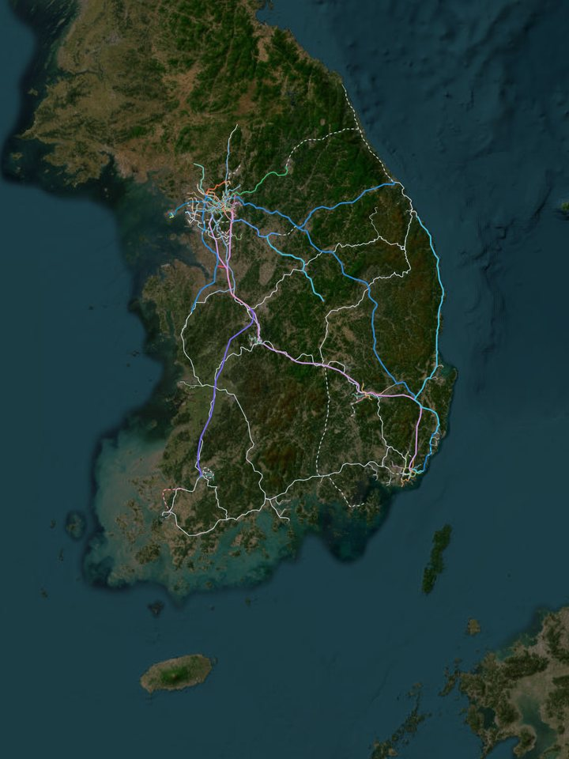 | 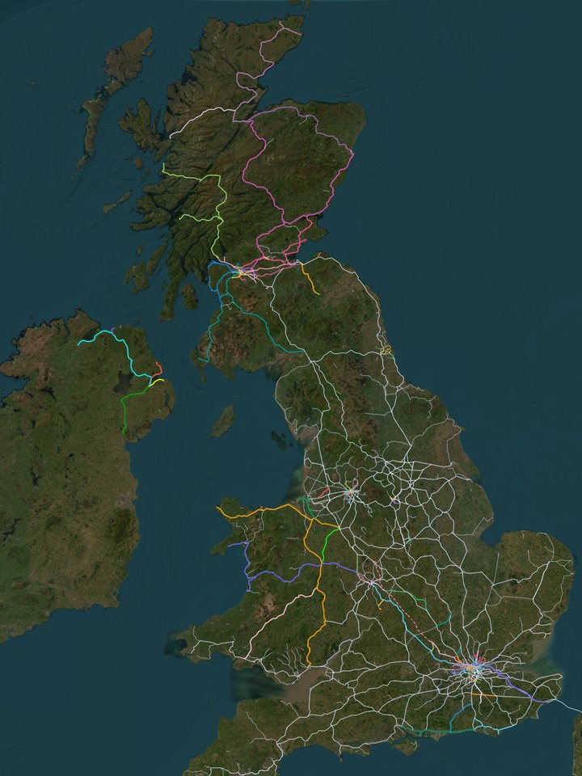 | 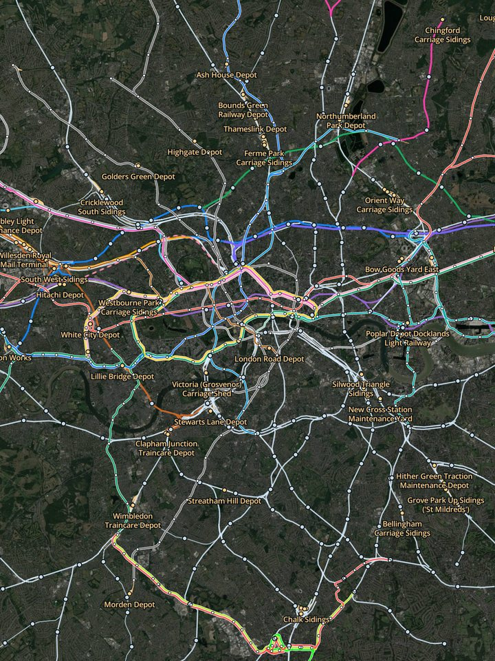 |
| South Korea | The UK | London |

## Coverage

| Country | What is on the map |
|---|---|
| China | Mainland China, Hong Kong, Macau and Taiwan. National railways coloured by the design speed of each section; metro, light rail, trams and suburban lines in every city; yards and depots; trains; routes between stations |
| Japan | All railways; metro, monorail and tram lines in every city; Shinkansen coloured by the design standard of each completed section |
| South Korea | All railways; metro and light rail in Seoul, Busan, Daegu, Incheon, Daejeon and Gwangju; high-speed and semi-high-speed lines in speed bands, some speeds still to be confirmed |
| UK | All railways (including Northern Ireland), heritage railways, the London Underground, the DLR and the trams of each city; High Speed 1 in the 300 band |

## Data and licences

- Lines, stations and yards: © [OpenStreetMap](https://www.openstreetmap.org/copyright) contributors, ODbL. Geofabrik extracts of 2026-10-05 (China), 2026-10-06 (Japan, South Korea) and 2026-10-03 (UK).
- Design speeds: [China EMU line records](https://www.china-emu.cn/RailRoads/) and published sources for each line, cited section by section; where only an operating speed was found, the band is marked as unconfirmed.
- Train timetable: [Chinese Railway GTFS](https://github.com/wensimehrp/chinese-railway-gtfs) (wensimehrp), [CC BY 4.0](https://creativecommons.org/licenses/by/4.0/), collected upstream by RailGo-Parser. Filtered, simplified and converted here, with sections that stray from the map's lines moved onto them; see `data/trains/README.md`. It is not official 12306 data. Station delays are fetched from [RailGo](https://railgo.dev/) only when a reader asks for them.
- Satellite imagery: Esri World Imagery (Esri, Maxar, Earthstar Geographics), loaded online and not part of this repository.
- China's route length figures come from the Ministry of Transport's 2025 statistical bulletin.
- Software: [MapLibre GL JS](https://maplibre.org/), the [PMTiles](https://github.com/protomaps/PMTiles) reader (BSD-3-Clause), and the Open Sans font (SIL Open Font License).

## Running it locally

```bash
python3 scripts/serve.py
```

Then open http://localhost:8765 . The page source is `src/app.html`; after changing it, run `python3 scripts/build.py`.

Rebuilding the data needs Python 3 (`osmium`, `shapely`, `numpy`), [tippecanoe](https://github.com/felt/tippecanoe), and the Geofabrik `china`, `taiwan`, `japan-latest`, `south-korea-latest` and `united-kingdom` `.osm.pbf` files in `data/raw/`:

```bash
python3 scripts/build_border.py              # borders
python3 scripts/extract_osm.py               # extract China; add jp, kr or uk for the others
python3 scripts/process_jp.py                # Japan's layers; process_kr.py and process_uk.py for Korea and the UK
python3 scripts/extract_design_points.py     # boundary points of the design-speed sections
python3 scripts/process_osm.py               # China's layers, coloured by design speed
python3 scripts/build_graph.py               # the network for routes between stations
python3 scripts/build_trains.py --download   # train timetable
python3 scripts/build_tiles.py               # vector tiles, data/tiles/<country>.pmtiles
python3 scripts/build.py                     # the page
python3 scripts/check_layers.py              # checks for breaks, duplicates and lines off their track
python3 -m unittest discover -s tests
```

The same data and code always give the same result.

## Licence

The code, page and documentation are under [PolyForm Noncommercial 1.0.0](LICENSE): free for study, research, personal and teaching use, and to modify and share; **commercial use needs written permission** from the author (open an Issue in this repository). The data stay under their own licences, listed above.
